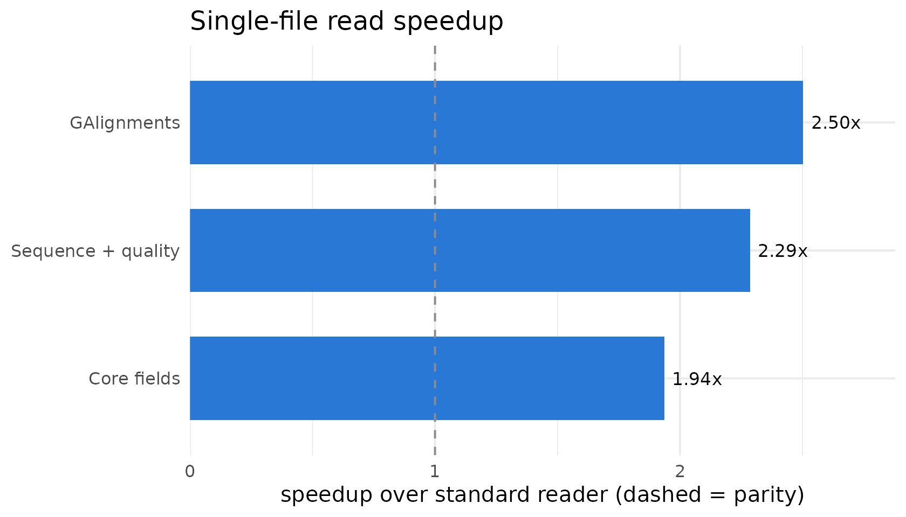
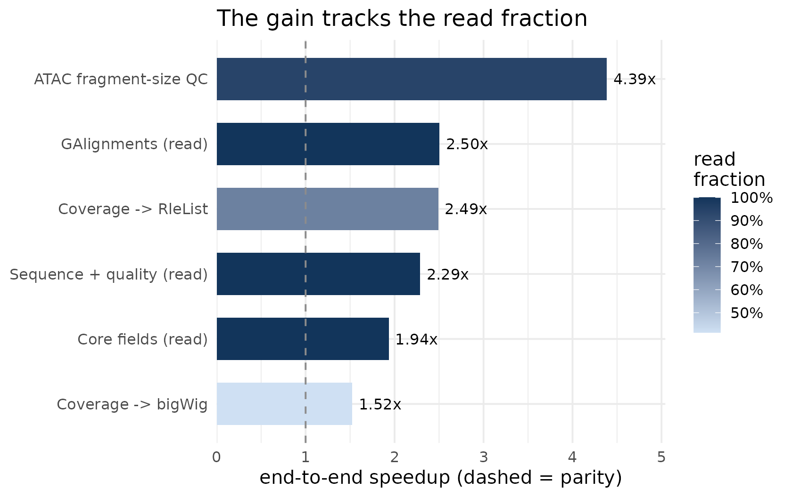

# Benchmarking BamScaleR: reader throughput and end-to-end workflow impact

## Overview

`BamScaleR` is a multithreaded BAM reader, built on the `ompBAM` OpenMP
engine, that returns the same native Bioconductor objects as the
standard readers, so it can take the place of
[`Rsamtools::scanBam`](https://rdrr.io/pkg/Rsamtools/man/scanBam.html)
and
[`GenomicAlignments::readGAlignments`](https://rdrr.io/pkg/GenomicAlignments/man/readGAlignments.html)
in existing analyses (see
[`?bam_read`](https://cparsania.github.io/BamScaleR/reference/bam_read.md)
for the differences).

Reading a BAM is only one step of an analysis, so a faster reader speeds
a workflow end-to-end **only in proportion to the time that workflow
spends reading** (Amdahl’s law). This vignette summarises benchmarks
that quantify *both* the raw read speedup and its end-to-end effect on
two standard workflows — coverage/bigWig track generation and ATAC-seq
fragment-size QC — with BamScaleR output verified **identical** to that
of the standard tools.

The numbers below are a concise summary of a representative benchmark
run (a deeply sequenced public ENCODE ATAC-seq BAM, ENCFF191LNL,
151,057,932 alignments; Intel Xeon Gold 6252, 96 logical cores; warm
page cache; median of 5 iterations). They are computed, when this
vignette is built, from summary tables shipped with the package (see
[Data provenance](#data-provenance)). The benchmark harness that
produces them is in `inst/benchmarks/` (`run_server_benchmark.R`,
`run_workflow_benchmark.R`); see the last section to reproduce the full
results.

## Read throughput on a single large BAM

On a single large BAM, BamScaleR reads **1.9–2.5x faster** than the
standard reader across three representative access patterns, because it
spreads the BGZF decode across cores and assembles the output objects in
native code:

| Workload | Reads | Standard (s) | BamScaleR (s) | Threads | Speedup |
|:---|:---|---:|---:|---:|:---|
| Core fields | qname/flag/rname/pos/mapq/cigar | 263.3 | 136.0 | 36 | 1.94x |
| GAlignments | -\> GAlignments object | 290.1 | 115.9 | 72 | 2.50x |
| Sequence + quality | seq + base quality | 409.8 | 179.3 | 24 | 2.29x |

Single-file read throughput: best BamScaleR configuration vs the
single-threaded standard reader (median of 5 iterations). {.table}



Two points. At **one thread** BamScaleR is 1.0–1.3x as fast as the
single-threaded readers (from native-code object assembly); most of the
win comes from threading, and the scaling is **strongly sublinear**:
going from 1 to 48 threads speeds BamScaleR itself up by 1.6–1.9x, and
no thread count beyond 24 is more than 10.2% faster than 24 threads. The
value is not near-linear scaling but the ability to use cores that a
single-threaded reader cannot use at all – as on one large BAM in an
interactive session. Object-free command-line decoders such as
`samtools` reach several-fold higher *raw* throughput, but return no
Bioconductor object; BamScaleR’s role is fast, object-faithful decoding
*inside* R.

## End-to-end impact tracks the read fraction

Embedding BamScaleR as the read step of a complete workflow, the
end-to-end speedup follows how read-dominated that workflow is (Amdahl’s
law):

| Endpoint                  | Layer    | Read fraction | Speedup |
|:--------------------------|:---------|:--------------|:--------|
| ATAC fragment-size QC     | workflow | 94%           | 4.39x   |
| GAlignments (read)        | read     | 100%          | 2.50x   |
| Coverage -\> RleList      | workflow | 72%           | 2.49x   |
| Sequence + quality (read) | read     | 100%          | 2.29x   |
| Core fields (read)        | read     | 100%          | 1.94x   |
| Coverage -\> bigWig       | workflow | 41%           | 1.52x   |

End-to-end speedup by workload endpoint. Read-pattern rows are
single-file read throughput; workflow rows are end-to-end. Read fraction
is the share of the standard pipeline spent reading. {.table}



- **ATAC fragment-size QC** is nearly pure read, so BamScaleR’s read
  speedup carries through almost intact: **4.39x** end-to-end.
- **Coverage -\> bigWig** is dominated by the shared, single-threaded
  [`rtracklayer::export.bw`](https://rdrr.io/pkg/rtracklayer/man/BigWigFile.html)
  step (identical work on both arms), so the end-to-end gain is bounded
  at **1.52x** even though the read phase itself is 5.9x faster.
  Stopping at the in-memory coverage `RleList` – what many analyses
  consume next – recovers a **2.49x** gain.
  ([`bam_coverage()`](https://cparsania.github.io/BamScaleR/reference/bam_coverage.md)
  and
  [`bam_coverage_bigwig()`](https://cparsania.github.io/BamScaleR/reference/bam_coverage_bigwig.md)
  compute these endpoints directly inside the reader, removing the
  R-side read phase entirely; see the function documentation.)

## A note on cores and fairness

A multithreaded reader can occupy cores a single-threaded one cannot. At
**matched core counts** (both arms given the same number of cores) the
two readers are within about 20% of each other for multi-file processing
(coverage ~1.20x, ATAC ~0.97x): the single-threaded reader already
saturates a machine by parallelising *across* files, so BamScaleR’s
multi-file advantage comes specifically from also threading *within* a
file – which pays off when there are fewer files than cores.

## Beyond reading: in-reader aggregation

For workflows whose endpoint is a summary rather than the alignments
themselves, BamScaleR provides four functions that fold the computation
inside the multithreaded reader, so no per-read R objects are ever
materialised:
[`fragment_sizes()`](https://cparsania.github.io/BamScaleR/reference/fragment_sizes.md)
(paired-end fragment-size distribution),
[`mapq_dist()`](https://cparsania.github.io/BamScaleR/reference/mapq_dist.md)
(mapping-quality distribution),
[`bam_coverage()`](https://cparsania.github.io/BamScaleR/reference/bam_coverage.md)
(per-base coverage `RleList`), and
[`bam_coverage_bigwig()`](https://cparsania.github.io/BamScaleR/reference/bam_coverage_bigwig.md)
(single-pass BAM to bigWig with parallel block compression). The first
three are tested [`identical()`](https://rdrr.io/r/base/identical.html)
to `table(abs(scanBam(isize)))`, `table(scanBam(mapq))` and
`coverage(readGAlignments())`; the bigWig, read back with `rtracklayer`,
has the same values as
[`bam_coverage()`](https://cparsania.github.io/BamScaleR/reference/bam_coverage.md),
and its parallel compression gives a file byte-identical to the
package’s own serial writer. These remove the R-side read phase from the
Amdahl decomposition above; their benchmarks are not part of the data
shipped with this vignette.

## Output is identical to the standard tools

Before the timings, the outputs were checked against the standard tools.
On the full files, at one thread, the coverage `RleList` was
[`identical()`](https://rdrr.io/r/base/identical.html) to
[`GenomicAlignments::coverage()`](https://rdrr.io/pkg/IRanges/man/coverage-methods.html)
on `readGAlignments` output, and the ATAC fragment-size table was
[`identical()`](https://rdrr.io/r/base/identical.html) to the one from
[`Rsamtools::scanBam`](https://rdrr.io/pkg/Rsamtools/man/scanBam.html)
and to `ATACseqQC::fragSizeDist` over all 151,057,932 alignments; the
read-pattern outputs were checked on a 1-kb window
(`benchmark_correctness.csv`). The package’s unit tests compare coverage
with `coverage(readGAlignments())` and the fragment-size and MAPQ tables
with `scanBam()` on the example BAM at 1, 2 and 4 threads.

## Try it

``` r

library(BamScaleR)
bam <- ompBAM::example_BAM("Unsorted")

## Alignment fields as a GAlignments object (as from readGAlignments)
ga <- bam_read(bam, what = c("rname", "pos", "cigar", "strand"),
               as = "GAlignments", threads = 2)
ga
```

    ## GAlignments object with 10000 alignments and 0 metadata columns:
    ##           seqnames strand              cigar    qwidth     start       end
    ##              <Rle>  <Rle>        <character> <integer> <integer> <integer>
    ##       [1]       19      +      1S88M6798N61M       150    572614    579560
    ##       [2]       19      -           1S148M1S       150    579499    579646
    ##       [3]        6      +           60S86M4S       150  44252112  44252197
    ##       [4]        6      -           1S146M3S       150  44252124  44252269
    ##       [5]       12      +             1S149M       150  46185884  46186032
    ##       ...      ...    ...                ...       ...       ...       ...
    ##    [9996]        2      -         16S122M12S       150 186680457 186680578
    ##    [9997]       15      +           4S143M3S       150  90501177  90501319
    ##    [9998]       15      -        26M2I56M66S       150  90501301  90501382
    ##    [9999]        4      + 3M336N95M752N51M1S       150 121801488 121802724
    ##   [10000]        4      -      1S117M121N32M       150 121802677 121802946
    ##               width     njunc
    ##           <integer> <integer>
    ##       [1]      6947         1
    ##       [2]       148         0
    ##       [3]        86         0
    ##       [4]       146         0
    ##       [5]       149         0
    ##       ...       ...       ...
    ##    [9996]       122         0
    ##    [9997]       143         0
    ##    [9998]        82         0
    ##    [9999]      1237         2
    ##   [10000]       270         1
    ##   -------
    ##   seqinfo: 25 sequences from an unspecified genome

``` r

## ...or core fields as a data.frame; `threads` controls within-file parallelism
df <- bam_read(bam, what = c("qname", "flag", "mapq"),
               as = "data.frame", threads = 2)
head(df)
```

    ##                                       qname flag mapq
    ## 1  ST-E00600:137:H77Y3CCXY:1:1101:6837:1309  163  255
    ## 2  ST-E00600:137:H77Y3CCXY:1:1101:6837:1309   83  255
    ## 3 ST-E00600:137:H77Y3CCXY:1:1101:10450:1309  163  255
    ## 4 ST-E00600:137:H77Y3CCXY:1:1101:10450:1309   83  255
    ## 5 ST-E00600:137:H77Y3CCXY:1:1101:15077:1309   99  255
    ## 6 ST-E00600:137:H77Y3CCXY:1:1101:15077:1309  147  255

## Data provenance

Every result in this vignette is computed, when the vignette is built,
from four small CSV files shipped with the package in `inst/extdata/`:

``` r

## Benchmark summary tables shipped with the package (see "Data provenance").
extdata <- function(f) {
  system.file("extdata", f, package = "BamScaleR", mustWork = TRUE)
}
bench    <- read.csv(extdata("benchmark_summary.csv"))
manifest <- read.csv(extdata("benchmark_encode_manifest.csv"))
checks   <- read.csv(extdata("benchmark_correctness.csv"))
run_info <- read.csv(extdata("benchmark_run_info.csv"))
info     <- setNames(run_info$value, run_info$field)
```

- `benchmark_summary.csv`: one row per benchmarked configuration (54
  rows): median wall-clock time and, for the single-file workflows, the
  median read, compute and write phases.
- `benchmark_encode_manifest.csv`: the 25 public ENCODE ATAC-seq
  alignment BAMs (accession, experiment, biosample, size, md5 checksum,
  read count and download URL).
- `benchmark_run_info.csv`: host, software versions and git commit of
  the run.
- `benchmark_correctness.csv`: the output-equivalence checks the timings
  were gated on.

They are a subset of the result tables of benchmark run final_20261008
(started 2026-10-08; BamScaleR 0.99.1 at git commit 30f6194; R 4.6.1;
Intel Xeon Gold 6252, 96 logical cores), produced by the harness in
`inst/benchmarks/` and reduced to these files by
`inst/scripts/make_benchmark_extdata.R`. The header of that script
records the exact command line of every step: corpus selection from the
ENCODE portal (`select_encode_atac.R`), md5-verified download
(`download_atac_data.R`), the read-pattern and workflow benchmarks
(`run_server_benchmark.R`, `run_workflow_benchmark.R`), and merging of
the staged runs (`merge_runs.R`).

The summary numbers are derived as follows:

- **Read patterns** compare the single-threaded standard reader with
  BamScaleR’s fastest configuration over a sweep of 1, 2, 4, 8, 12, 24,
  36, 48, 72 OpenMP threads, on the same file, both returning the same
  object.
- **Workflows** take, for each arm, the configuration with the lowest
  median end-to-end time. An endpoint’s time is the sum of its median
  phases (read + compute, plus the track write for the bigWig endpoint),
  and its read fraction is the standard pipeline’s read time divided by
  that sum.
- **Matched cores** divide the standard arm’s median time by BamScaleR’s
  on the 24-file cohort, with both arms running one thread per file on
  the same number of cores.

| Role | Accession | Experiment | Biosample | Reads (M) | Size (GB) |
|:---|:---|:---|:---|---:|---:|
| single | [ENCFF191LNL](https://www.encodeproject.org/files/ENCFF191LNL/) | ENCSR040DJK | psoas muscle | 151.1 | 7.34 |
| multi | [ENCFF590EOC](https://www.encodeproject.org/files/ENCFF590EOC/) | ENCSR904UKR | dendritic cell | 107.7 | 4.50 |
| multi | [ENCFF919PWF](https://www.encodeproject.org/files/ENCFF919PWF/) | ENCSR608KJD | HG03097 | 77.8 | 4.50 |
| multi | [ENCFF988EGP](https://www.encodeproject.org/files/ENCFF988EGP/) | ENCSR762YFD | GM18520 | 66.1 | 4.48 |
| multi | [ENCFF512LHW](https://www.encodeproject.org/files/ENCFF512LHW/) | ENCSR641KNU | GM21825 | 78.8 | 4.46 |
| multi | [ENCFF403LDD](https://www.encodeproject.org/files/ENCFF403LDD/) | ENCSR954BDA | GM21529 | 83.6 | 4.43 |
| multi | [ENCFF342KIA](https://www.encodeproject.org/files/ENCFF342KIA/) | ENCSR231BZU | GM19351 | 86.3 | 4.41 |
| multi | [ENCFF130DND](https://www.encodeproject.org/files/ENCFF130DND/) | ENCSR858GTE | HG03442 | 82.3 | 4.41 |
| multi | [ENCFF205LVV](https://www.encodeproject.org/files/ENCFF205LVV/) | ENCSR373TDL | right lobe of liver | 79.5 | 4.36 |
| multi | [ENCFF603MOL](https://www.encodeproject.org/files/ENCFF603MOL/) | ENCSR312UCH | GM18519 | 65.3 | 4.33 |
| multi | [ENCFF588QWF](https://www.encodeproject.org/files/ENCFF588QWF/) | ENCSR554WGQ | HG03280 | 78.0 | 4.32 |
| multi | [ENCFF704VYQ](https://www.encodeproject.org/files/ENCFF704VYQ/) | ENCSR848TMJ | heart left ventricle | 87.6 | 4.30 |
| multi | [ENCFF930RKA](https://www.encodeproject.org/files/ENCFF930RKA/) | ENCSR584AXZ | coronary artery | 74.6 | 4.27 |
| multi | [ENCFF397GZQ](https://www.encodeproject.org/files/ENCFF397GZQ/) | ENCSR831KAH | tibial nerve | 74.5 | 4.26 |
| multi | [ENCFF321SNO](https://www.encodeproject.org/files/ENCFF321SNO/) | ENCSR404OEO | HG02763 | 78.0 | 4.26 |
| multi | [ENCFF751SRZ](https://www.encodeproject.org/files/ENCFF751SRZ/) | ENCSR902CFR | GM21423 | 77.9 | 4.25 |
| multi | [ENCFF423JSR](https://www.encodeproject.org/files/ENCFF423JSR/) | ENCSR210NKB | testis | 71.9 | 4.23 |
| multi | [ENCFF204XQS](https://www.encodeproject.org/files/ENCFF204XQS/) | ENCSR084FHK | GM18505 | 71.1 | 4.22 |
| multi | [ENCFF524VNU](https://www.encodeproject.org/files/ENCFF524VNU/) | ENCSR237VSF | dendritic cell | 105.5 | 4.20 |
| multi | [ENCFF199OKA](https://www.encodeproject.org/files/ENCFF199OKA/) | ENCSR065CER | motor neuron | 105.3 | 4.20 |
| multi | [ENCFF825QCZ](https://www.encodeproject.org/files/ENCFF825QCZ/) | ENCSR115OIV | activated T-helper 17 cell | 85.5 | 4.17 |
| multi | [ENCFF978QLZ](https://www.encodeproject.org/files/ENCFF978QLZ/) | ENCSR368FYV | HG02852 | 79.5 | 4.17 |
| multi | [ENCFF275GRM](https://www.encodeproject.org/files/ENCFF275GRM/) | ENCSR131HOY | motor neuron | 96.5 | 4.16 |
| multi | [ENCFF373DIW](https://www.encodeproject.org/files/ENCFF373DIW/) | ENCSR024WOD | GM21390 | 73.0 | 4.13 |
| multi | [ENCFF557GPJ](https://www.encodeproject.org/files/ENCFF557GPJ/) | ENCSR122NDR | GM21576 | 75.3 | 4.13 |

The 25 public ENCODE ATAC-seq alignment BAMs (GRCh38, paired-end)
benchmarked. The single file is the target of every single-file
benchmark; the 24 multi files form the cohort of the matched-cores
comparison. Read counts are the ENCODE QC total reads; md5 checksums and
download URLs are in benchmark_encode_manifest.csv. {.table}

## Reproducing the full benchmarks

The complete benchmark harness ships under `inst/benchmarks/`; its
`README.md` lists the additional packages and command-line tools it
needs.

``` r

dir(system.file("benchmarks", package = "BamScaleR"))
# select_encode_atac.R        : select the ATAC-seq corpus from the ENCODE portal
# download_atac_data.R        : fetch, md5-verify and index the selected BAMs
# run_server_benchmark.R      : read-pattern micro-benchmarks (step1 / GAlignments / seq+qual)
# run_workflow_benchmark.R    : end-to-end coverage and ATAC fragment-size QC workflows
# merge_runs.R                : merge staged runs into one result directory

## Reduce a finished run to the CSVs this vignette reads
system.file("scripts", "make_benchmark_extdata.R", package = "BamScaleR")
```

Each benchmark writes machine-readable result tables (`summary.csv`)
plus host and correctness metadata; `make_benchmark_extdata.R` extracts
from them the files in `inst/extdata/` from which the summary figures
above are derived.

## Session information

    ## R version 4.6.2 (2026-10-29)
    ## Platform: x86_64-pc-linux-gnu
    ## Running under: Ubuntu 26.04.1 LTS
    ## 
    ## Matrix products: default
    ## BLAS:   /usr/lib/x86_64-linux-gnu/openblas-pthread/libblas.so.3 
    ## LAPACK: /usr/lib/x86_64-linux-gnu/openblas-pthread/libopenblasp-r0.3.32.so;  LAPACK version 3.12.0
    ## 
    ## locale:
    ##  [1] LC_CTYPE=C.UTF-8       LC_NUMERIC=C           LC_TIME=C.UTF-8       
    ##  [4] LC_COLLATE=C.UTF-8     LC_MONETARY=C.UTF-8    LC_MESSAGES=C.UTF-8   
    ##  [7] LC_PAPER=C.UTF-8       LC_NAME=C              LC_ADDRESS=C          
    ## [10] LC_TELEPHONE=C         LC_MEASUREMENT=C.UTF-8 LC_IDENTIFICATION=C   
    ## 
    ## time zone: UTC
    ## tzcode source: system (glibc)
    ## 
    ## attached base packages:
    ## [1] stats     graphics  grDevices utils     datasets  methods   base     
    ## 
    ## other attached packages:
    ## [1] BamScaleR_0.99.5 ggplot2_4.0.4    BiocStyle_2.40.0
    ## 
    ## loaded via a namespace (and not attached):
    ##  [1] sass_0.5.0                  generics_0.1.4             
    ##  [3] bitops_1.1-0                SparseArray_1.12.3         
    ##  [5] lattice_0.23-1              digest_0.6.39              
    ##  [7] evaluate_1.0.5              grid_4.6.2                 
    ##  [9] RColorBrewer_1.1-3          bookdown_0.48              
    ## [11] fastmap_1.2.0               Matrix_1.7-6               
    ## [13] jsonlite_2.0.0              cigarillo_1.2.1            
    ## [15] GenomeInfoDb_1.48.0         BiocManager_1.30.27        
    ## [17] httr_1.4.9                  UCSC.utils_1.8.0           
    ## [19] scales_1.4.0                Biostrings_2.80.2          
    ## [21] codetools_0.2-20            textshaping_1.1.0          
    ## [23] jquerylib_0.1.4             abind_1.4-8                
    ## [25] cli_3.6.6                   rlang_1.3.0                
    ## [27] crayon_1.5.3                XVector_0.52.0             
    ## [29] ompBAM_1.16.0               Biobase_2.72.0             
    ## [31] DelayedArray_0.38.2         withr_3.0.3                
    ## [33] cachem_1.1.0                yaml_2.3.12                
    ## [35] otel_0.3.0                  S4Arrays_1.12.1            
    ## [37] tools_4.6.2                 parallel_4.6.2             
    ## [39] BiocParallel_1.46.0         Rsamtools_2.28.0           
    ## [41] SummarizedExperiment_1.42.0 BiocGenerics_0.58.1        
    ## [43] vctrs_0.7.3                 R6_2.6.1                   
    ## [45] matrixStats_1.5.0           stats4_4.6.2               
    ## [47] lifecycle_1.0.5             Seqinfo_1.2.0              
    ## [49] S4Vectors_0.50.3            fs_2.1.0                   
    ## [51] IRanges_2.46.0              ragg_1.5.2                 
    ## [53] desc_1.4.3                  pkgdown_2.2.1              
    ## [55] bslib_0.12.0                gtable_0.3.6               
    ## [57] glue_1.8.1                  Rcpp_1.1.2                 
    ## [59] systemfonts_1.3.4           xfun_0.62                  
    ## [61] GenomicAlignments_1.48.0    GenomicRanges_1.64.0       
    ## [63] MatrixGenerics_1.24.0       knitr_1.52                 
    ## [65] farver_2.1.2                htmltools_0.5.9            
    ## [67] rmarkdown_2.32              labeling_0.4.3             
    ## [69] compiler_4.6.2              S7_1.0.0
